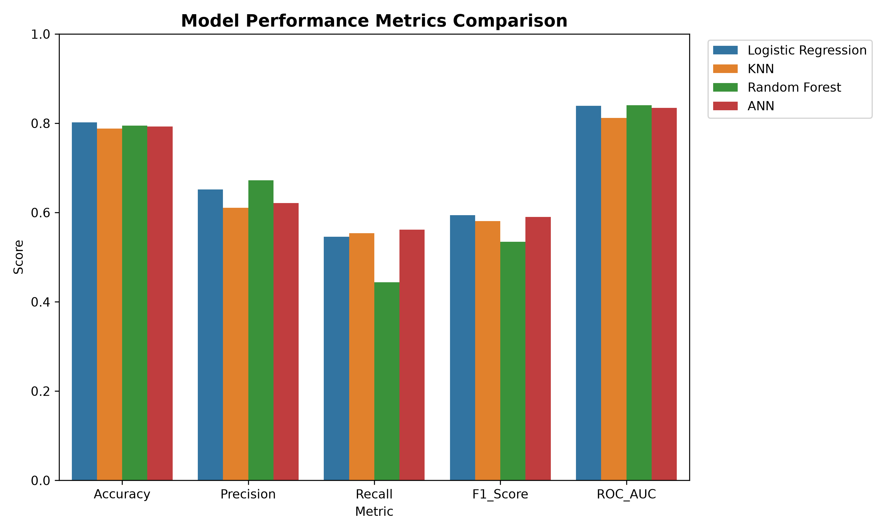
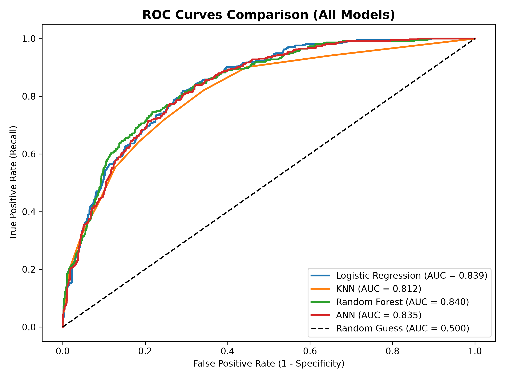
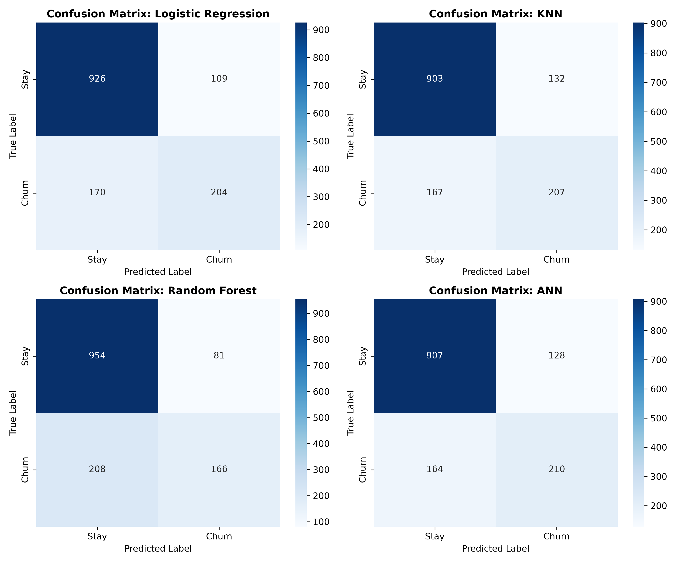

# 📡 Telecom Customer Churn Prediction System

**AI/ML Internship Project 5 Specification**  
**Organization:** Verveox Technologies  
**Domain:** Artificial Intelligence & Machine Learning  
**Application:** Interactive Predictive Analytics Dashboard  

[](https://www.python.org/)
[](https://streamlit.io/)
[](https://www.tensorflow.org/)
[](LICENSE)

---

## 📌 Executive Summary
Customer churn occurs when telecom subscribers discontinue their services. Because acquiring new customers costs 5 to 25 times more than retaining existing ones, accurately identifying at-risk customers enables telecom providers to execute targeted retention strategies (discounts, contract upgrades, customer support).

This project implements an academically sound, end-to-end Machine Learning and Deep Learning system that predicts customer churn probabilities using real-world customer subscription, billing, and demographic attributes.

---

## 🖥️ Live Application Demo & Interface

The application features a custom **Classic Burgundy & Beige** aesthetic inspired by **Game of Thrones (*Cinzel*)** typography and **Vintage Mechanical Typewriter (*Special Elite*)** dispatch verdict cards.

### 🎮 How the Live Demo Operates:
1. **Dynamic Customer Profile Form:** Real-time input for demographics, subscribed telecom services (Fiber optic, DSL, Streaming), and contract terms.
2. **Instant Preprocessing Pipeline:** Raw inputs are automatically one-hot encoded, scaled, and feature-selected using the trained pipeline.
3. **Multi-Model Inference:** Allows evaluators to toggle live between the **Champion Logistic Regression**, **Deep Artificial Neural Network (ANN)**, **Random Forest**, and **KNN** models!

### 📋 Sample Prediction Scenarios Demonstrated:

| Customer Profile | Contract & Billing | AI Prediction Verdict | Churn Risk | Retention Action |
| :--- | :--- | :---: | :---: | :--- |
| **New High-Bill Subscriber** | Month-to-Month, \$95/mo, Tenure: 2 mos | 🚨 **LIKELY TO CHURN** | **78.4% Risk** | Immediate annual discount upgrade advised |
| **Long-Term Loyal Subscriber**| Two-Year, \$45/mo, Tenure: 55 mos | 🛡️ **LIKELY TO STAY** | **7.3% Risk** | Healthy relationship; standard support |

---

## 📊 Model Benchmark & Comparative Performance

All four algorithms were trained, tuned with **5-Fold Stratified Cross-Validation (`GridSearchCV`)**, and evaluated on the exact same unseen test set (1,409 customer records):

| Model Algorithm | Accuracy | Precision | Recall | F1-Score | ROC-AUC |
| :--- | :---: | :---: | :---: | :---: | :---: |
| **Logistic Regression (Champion)** | **80.20%** | 65.18% | 54.55% | **0.5939** | 0.8389 |
| **Artificial Neural Network (ANN)** | 79.28% | 62.13% | **56.15%** | 0.5899 | 0.8346 |
| **Random Forest Classifier** | 79.49% | **67.21%** | 44.39% | 0.5346 | **0.8402** |
| **K-Nearest Neighbors (KNN)** | 78.78% | 61.06% | 55.35% | 0.5806 | 0.8118 |

### 📈 Evaluation Visualizations:
<p align="center">
  
  
</p>

<p align="center">
  
</p>

---

## 🚀 Quick Start / How to Run the Demo Locally

Anyone (faculty, examiners, or recruiters) can launch the interactive dashboard on their computer with two commands:

```bash
# 1. Install dependencies
pip install -r requirements.txt

# 2. Launch the interactive dashboard
streamlit run app/app.py